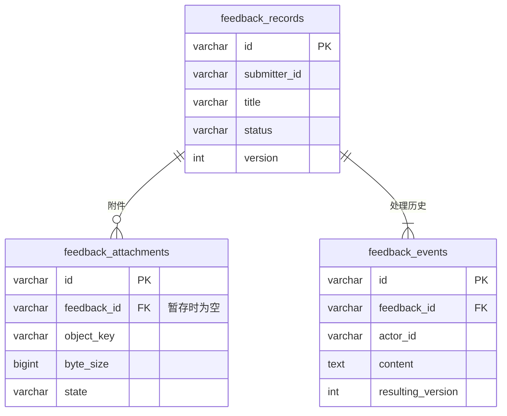

# 问题反馈：实现与部署说明

反馈属于平台自己的业务，不调用供应方的模型或知识库接口。用户端提交、后台处理和用户查看结果已经接入同一套 PostgreSQL 记录；文件正文保存在私有 MinIO 桶。

**当前联调阻塞（2026-09-17 下午）**：远端主库的迁移标记为 `20260917_auth01`，本地迁移链最新版本为 `20260917_01`。当前代码读取 `auth_session` 等认证表，远端使用的是另一版 `auth_sessions` 结构。执行 `alembic upgrade head` 因缺少 `20260917_auth01` 脚本失败，未修改远端表或数据。需先取得该版本的迁移脚本与配套认证代码，再统一迁移链和登录实现；不得通过改写版本标记、重建旧认证表或重跑反馈建表 SQL 来绕过。下文真实联调通过记录发生在此次版本不一致之前，不代表当前登录可用。

## 已实现

- 用户填写类型、模块、标题、描述和联系方式；“其他”需要补充说明。
- 附件可选，最多 3 个，单个最大 1 GiB（1,073,741,824 字节），支持 PNG/JPG/JPEG/PDF/DOCX。文件名和文件特征在服务端校验。
- 点击提交后逐个上传文件，显示上传进度；上传完成再原子保存反馈、附件关联和首次历史。失败保留输入，网络结果不确定时使用原请求编号核对和重试。
- 用户仅能查询本人反馈及下载本人反馈的附件；后台使用现有管理端权限。
- 后台分页、按标题查询、按状态筛选、数量统计、读取详情、下载附件、追加处理说明，状态为“处理中/已解决”。可以填写说明后恢复处理。
- 用户未提交时离开或刷新会提示；后台未保存回复或状态时关闭详情、离开或刷新也会提示。取消操作保留当前输入，确认放弃后清空；不提供自动草稿保存。
- 详情中的长联系方式和附件名自动换行；后台处理区位于历史记录前，保存按钮固定在详情底部。
- 回复追加到历史，不覆盖旧内容；版本号防止两位管理员同时保存时互相覆盖；每次详情返回最多 20 条历史，支持继续读取。
- 未提交文件暂存 24 小时。每个后端进程每 5 分钟领取最多 10 条到期记录；数据库行锁及绑定条件保证只清理暂存附件。取消/清理保留删除标记，处理迟到上传和删除失败。

## 三张表

| 表 | 用途 |
| --- | --- |
| `feedback_records` | 原始内容、提交人身份快照、当前状态、版本和提交请求编号 |
| `feedback_attachments` | 文件名、大小、摘要、MinIO 定位、归属、上传状态和有效期；不存文件正文 |
| `feedback_events` | 提交、回复、解决和恢复处理的追加历史，以及处理人身份快照 |

身份复用已有认证的稳定用户标识，不新增完整用户表，也不把业务归属绑定到可过期的登录会话。

## 部署

1. 更新三端代码并确认本地迁移链能识别目标数据库的当前版本，再执行 `python -m alembic upgrade head`，成功后启动新后端。反馈迁移版本为 `20260917_01`，只创建反馈三张表和索引。当前共享库存在上方所述认证迁移版本不一致，须先处理该阻塞。
2. `feedback-schema.sql` 是与 ORM 一致的 PostgreSQL 建表参考。已有 Alembic 项目使用迁移，**不要再执行该 SQL**。新环境也优先走完整迁移链，避免版本标记与表结构不一致。
3. 设置 MinIO S3 接口地址和应用凭据；本次本地配置使用已验证的私有桶 `aicollabhub-feedback`，对象前缀为 `feedback/attachments/`。数据库只记录定位，下载经平台鉴权转发；没有匿名读取或向前端暴露凭据。
4. `MINIO_MAX_UPLOAD_BYTES` 至少为 `1073741824`。`MINIO_TIMEOUT` 是存储连接/读写等待设置，当前配置为 10 秒；部署时按实际内网带宽验证并调整。1 GiB 的上传不是把整个文件读入前端 JS 或 Python 内存；服务端使用临时文件和分块传输。
5. 使用更新后的 `deploy/nginx/nginx.conf.template` 重新生成、检查并加载网关配置。反馈上传独立允许 `1025m` 请求、最长 `3600s` 等待；其余业务沿用原限制。若前面还有其他网关，也要同步核对这一条上传路径的大小与超时。
6. `FEEDBACK_UPLOAD_CONCURRENCY=2` 表示每个后端进程最多接收两个附件。临时磁盘至少为并发上传总数乘以 1 GiB 留出余量。每个请求只上传一个文件，一条反馈最多绑定三个。
7. 复用现有认证与 CSRF。当前联调是模拟 IAM（`AUTH_MODE=mock`），业务记录和文件是真实保存。正式 IAM 的对接属于既有认证模块工作；生产环境关闭认证时反馈接口会拒绝访问。

可按需执行 `python -m scripts.cleanup_feedback` 手动触发一批到期暂存清理。无需另设定时任务才能运行自动清理；已提交附件不会被临时清理器删除。

## 接口入口

| 用途 | 方法和路径（前缀 `/api/v1`） |
| --- | --- |
| 表单选项和限制 | `GET /feedback/config` |
| 上传/核对/取消暂存附件 | `POST /feedback/attachments`、`GET /feedback/uploads/{requestId}`、`DELETE /feedback/attachments/{id}` |
| 提交/分页/核对提交 | `POST /feedback`、`GET /feedback`、`GET /feedback/submissions/{requestId}` |
| 本人详情/下载 | `GET /feedback/{id}`、`GET /feedback/{id}/attachments/{attachmentId}/content` |
| 后台统计/列表/详情 | `GET /admin/overview`、`GET /admin/feedback`、`GET /admin/feedback/{id}` |
| 后台追加处理/下载 | `PATCH /admin/feedback/{id}`、`GET /admin/feedback/{id}/attachments/{attachmentId}/content` |

字段定义见 `app/modules/feedback/schemas.py` 与两端 `services/feedbackApi.ts`。列表状态是 `processing/resolved`，页面显示中文；附件提交的是编号列表，不是旧演示接口的附件名称。

## 验证与当前边界

后端测试覆盖身份隔离、CSRF、三附件限制、文件特征、大小边界、重试、防重复、绑定回滚、管理员版本冲突、历史分页、暂存取消清理以及迁移。旧迁移用例已同步到新增迁移版本。

`scripts/verify_feedback_ui.mjs` 用浏览器内的反馈响应夹具检查未保存保护、保存失败重试、长字段换行及固定底部按钮，不写入真实反馈或 MinIO。已检查 1440×1000、1366×768、390×844、320×844 四种尺寸；登录仍依赖本地模拟 IAM 和兼容的认证数据库，当前共享库阻塞解决后才可再次运行。

2026-09-17 验证结果：反馈及关联认证/存储 69 项测试通过，迁移回归 32 项通过，前端相关单元测试 21 项通过，两端类型检查和构建通过，桌面与移动端 4 项反馈控件回归通过。真实服务浏览器验收通过；随后按本次清单删除 6 条验收记录、12 个 MinIO 附件和 14 条处理历史。全量后端中的 18 项其他模块 PostgreSQL 专项测试因未配置其独立测试库而跳过。

`scripts/verify_feedback_browser.mjs` 对独立本地网关执行真实 PostgreSQL/MinIO 和浏览器验收，包括提交、刷新、下载、后台回复、解决、用户查看结果及并发冲突。需要已启动的服务、可用的模拟登录和安装好的 Playwright 浏览器。通过 `FEEDBACK_VERIFY_URL` 指定地址，默认 `http://127.0.0.1:18980`。脚本会创建标题带“反馈联调验收/反馈并发验收”的测试记录，并将精确编号保存在 `.runtime/feedback-preview/verification/created-records-*.json`，清理只能按这些编号执行。离线前端控件测试使用独立测试夹具，不会将演示数据放回业务代码。

当前实测使用小附件；1 GiB 上限已在前后端和网关实现，并有边界校验测试，尚未进行完整 1 GiB 文件的实际传输压测。

附件 `security_level` 与提交人组织字段已预留。统一密级字典与人员授权策略尚未接入，接口拒绝自定义密级；不能把预留字段视为已完成密级权限管理。

本次联调遇到远端 PostgreSQL 连接额度耗尽。2026-09-17 排查确认实例上限为 30、管理员保留 3，普通连接名额为 27；停止原预览后仍有 25 条其他业务连接。随后将反馈预览改为单个 worker、连接池 1、额外连接 0。现已将保守连接池设为代码和本地配置默认值，并添加本项目连接连续普通空闲 120 秒释放、借用时自动重连的机制。连接程序名自动包含环境、实例、主机和 PID，不再依赖启动时手动设置 `PGAPPNAME`。

本次修改的 85 项相关后端测试通过；真实 PostgreSQL 的连接上限、空闲释放、重连复用、查询与事务验证通过；重启预览后的登录和反馈页面检查通过。最新采样含诊断连接共 26 条，诊断退出后约 25 条，名额仍随其他客户端变化。连接设置只影响加载新代码后建立的连接，其他既有进程需自行重启或关闭。详细来源及处置步骤见本地 `docs/database-connection-audit-20260917.md`。正式部署需合计所有实例、worker、定时任务及其他客户端的连接预算，确认释放闲置实例或合理增加服务器额度。
